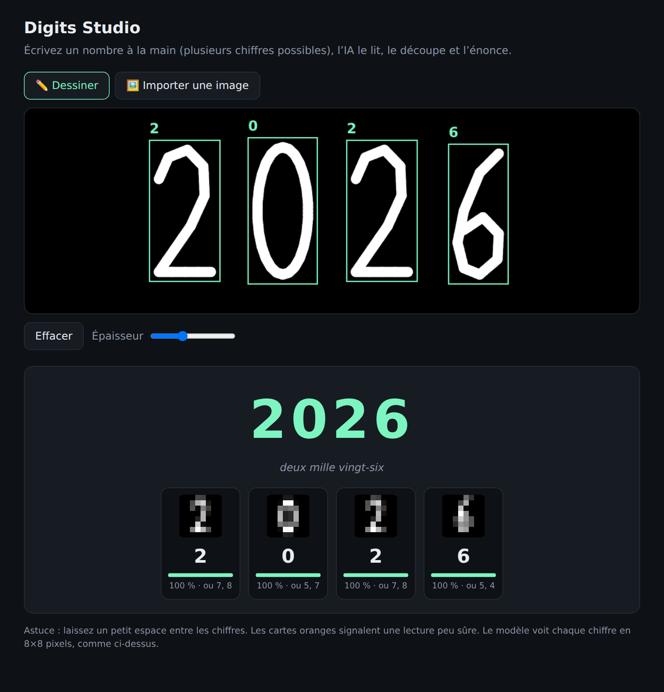
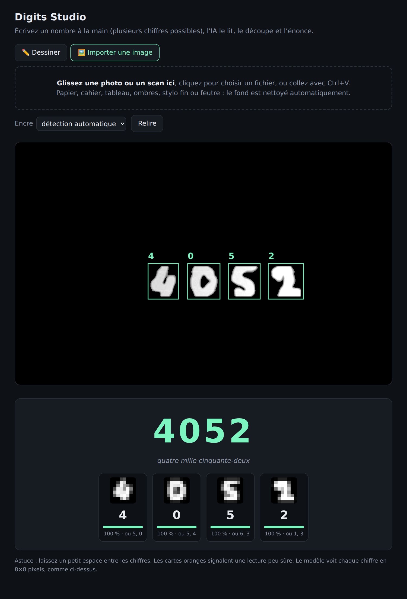
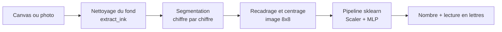

# 🔢 Digits Studio

[](https://github.com/HAYET-MEDINI/digits-studio/actions/workflows/ci.yml)


**Lecture de nombres manuscrits** (plusieurs chiffres) par un réseau de neurones multicouches (MLP) scikit-learn,
déployé avec Flask. On écrit un nombre à la souris ou on importe une photo / un scan : l'application le découpe
chiffre par chiffre, le lit, et l'énonce en toutes lettres.

<p align="center">
  
</p>

## Fonctionnalités

- **Nombres complets** : segmentation automatique des chiffres de gauche à droite, y compris quand ils se touchent.
- **Dessin à la souris ou au doigt** sur un canvas, lecture automatique.
- **Import d'une photo ou d'un scan** (JPG, PNG, WEBP, BMP, GIF) : glisser-déposer, clic ou `Ctrl+V`.
  Le fond est nettoyé automatiquement (papier, ombres, lignes de cahier, tableau noir, stylo fin ou feutre).
- **Lecture en français** : `4052` → « quatre mille cinquante-deux ».
- **Interface transparente** : boîtes de détection, vue 8×8 vue par le modèle, confiance et alternatives par chiffre ;
  les lectures peu sûres sont signalées en orange.

<p align="center">
  
</p>

> Captures générées par `scripts/take_screenshots.py` : vrai navigateur, vrai modèle, tracés à la souris simulés.
> La photo importée ci-dessus est [`docs/exemple-photo.jpg`](docs/exemple-photo.jpg), une fausse photo (papier ligné, ombre, JPEG compressé).

## Comment ça marche



**Pipeline scikit-learn** (`digits_studio/training.py`) : `MinMaxScaler → PCA (optionnelle) → MLPClassifier`,
réglé par `RandomizedSearchCV` (validation croisée groupée) sur le nombre de couches, l'activation, l'optimiseur,
`alpha` et le taux d'apprentissage.

**Pourquoi l'augmentation de données ?** Le dataset `load_digits` ne contient que des images 8×8 très propres.
Sans augmentation, le modèle s'effondre sur des tracés réalistes. Le jeu d'entraînement est donc enrichi (rotation,
cisaillement, échelle, décalage, épaisseur du trait, flou, bruit) et d'exemples qui suivent exactement le même chemin
que les photos (grande image déformée → prétraitement réel → 8×8).

## Résultats

Modèle retenu : MLP `(256, 128)`, activation `relu`, optimiseur `adam`, `alpha=0.01`, `MinMaxScaler`, sans PCA.

| Évaluation | Résultat |
|---|---|
| Jeu de test `load_digits` (360 images) | 98,6 % |
| Tracés manuscrits simulés (même jeu de test) | 95,3 % |

Benchmark de lecture de **nombres entiers** sur de fausses photos (`python -m scripts.benchmark_photos`,
12 nombres de 2 à 5 chiffres par cas, chiffres tirés du jeu de test uniquement) :

| Cas | Nombres lus exactement |
|---|---|
| Ombre et dégradé d'éclairage | 11 / 12 |
| Papier ligné avec marge | 11 / 12 |
| Stylo fin | 11 / 12 |
| Petits chiffres sur grande page | 11 / 12 |
| Photo inclinée (±6°) | 11 / 12 |
| Tableau noir, craie blanche | 11 / 12 |

⚠️ Ces tests sont des **simulations** construites à partir de `load_digits`, pas de vraies photos d'écriture humaine.
Les scores sur de vraies photos seront plus bas et dépendent de l'écriture et de la prise de vue.

## Installation

```bash
git clone https://github.com/HAYET-MEDINI/digits-studio.git
cd digits-studio

python -m venv .venv
source .venv/bin/activate          # Windows (Git Bash) : source .venv/Scripts/activate
                                   # Windows (PowerShell) : .venv\Scripts\Activate.ps1
pip install -r requirements.txt
```

## Utilisation

```bash
python run.py
```

Puis ouvrir <http://127.0.0.1:5000>. Deux onglets : **Dessiner** et **Importer une image**.

### API

| Route | Méthode | Entrée | Sortie |
|---|---|---|---|
| `/` | GET | — | Interface web |
| `/health` | GET | — | `{"status": "ok"}` |
| `/predict` | POST | JSON `{"image": "data:image/png;base64,..."}` (canvas blanc sur noir) | nombre, mots, détail par chiffre |
| `/predict_image` | POST | `multipart/form-data` : `file`, `polarity` (`auto`, `dark`, `light`) | idem + image nettoyée |

```bash
curl -F "file=@docs/exemple-photo.jpg" http://127.0.0.1:5000/predict_image
```

## Réentraîner le modèle

```bash
python -m digits_studio.training      # ≈ 3 à 5 minutes, écrit models/model.joblib
```

`models/model.joblib` est versionné pour que le projet fonctionne dès le clonage. Il a été sauvegardé avec
scikit-learn 1.8 : en cas d'avertissement ou d'erreur de version, relancez la commande ci-dessus.

## Tests

```bash
pip install -r requirements-dev.txt
pytest
python -m scripts.benchmark_photos 12      # benchmark sur fausses photos
python -m scripts.take_screenshots         # régénère les captures (nécessite: playwright install chromium)
```

L'intégration continue (GitHub Actions) exécute les tests sur Python 3.10, 3.11 et 3.12.

## Structure du projet

```
digits-studio/
├── digits_studio/            # package de l'application
│   ├── __init__.py           #   create_app() : fabrique Flask
│   ├── web.py                #   routes HTTP
│   ├── inference.py          #   segmentation → MLP → assemblage du nombre
│   ├── vision.py             #   nettoyage des photos, segmentation, passage en 8x8
│   ├── numbers_fr.py         #   nombre → lettres (français)
│   ├── training.py           #   augmentation + Pipeline + RandomizedSearchCV
│   └── templates/index.html  #   interface (canvas, import, résultats)
├── models/model.joblib       # pipeline entraîné
├── tests/                    # tests pytest (+ générateurs de données de test)
├── scripts/                  # benchmark et captures d'écran
├── docs/                     # captures d'écran et photo d'exemple
├── .github/workflows/ci.yml  # intégration continue
├── run.py                    # point d'entrée
└── requirements*.txt
```

## Limites

- Le modèle est entraîné sur `load_digits` (images 8×8) : certains chiffres proches peuvent être confondus
  (par exemple 3/7 ou 1/8). Un entraînement sur **MNIST** (70 000 chiffres écrits par des humains,
  `fetch_openml("mnist_784")`) serait la meilleure amélioration ; l'architecture n'aurait pas à changer.
- Un seul nombre, écrit sur **une ligne horizontale** ; pas de décimales ni de signes.
- Pour les photos : privilégier une prise de vue droite, de près, avec un bon contraste.

## Licence

[MIT](LICENSE)
